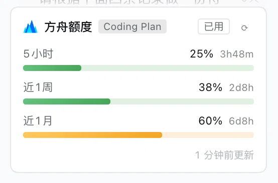

# dsh-ark-quota

English · [简体中文](./README.md)

A [DeepSeek Harness](https://github.com/deepseek-ai/DeepSeek-Harness) (DSH) plugin: a permanent sidebar widget for your **Volcano Ark Coding Plan subscription quota** — per-tier usage, burn pace and exhaustion forecast, following the current session's model across Volcengine accounts.



## Features

- **Sidebar card / collapsed pill**: 5-hour / weekly / monthly usage bars with reset countdowns; the most urgent tier stays visible on the collapsed pill, hover for all tiers
- **Burn pace & exhaustion forecast**: the 5-hour tier uses sliding-window water-level dynamics (net rise); weekly/monthly use average pace (quota progress ÷ time progress); recent burn comes from an exponentially weighted least-squares fit; the forecast is drawn onto the bar; snapshots persist via `storageDomain` across restarts
- **Follows the session model**: the card's identity is DSH's llm provider route — switching models in a session switches the Volcengine account shown; a route can be pinned
- **Multi-account**: saving keys for a route auto-creates its credential group; the same AK/SK entered for multiple routes merges into one account; falls back to Agent Plan (`GetAFPUsage`) when Coding Plan is not subscribed
- **Settings → 方舟额度 section**: pick a route, paste AK/SK, save — hot-applied, **no restart**

## Requirements

- DeepSeek Harness `dsh web` (DSH **0.2.0-rc.1 / rc.2**; see [compatibility notes](./docs/install.md#dsh-版本兼容性) — in Chinese)
- A Volcano Ark subscription and one **AK/SK** pair (Console → Access Control → API Access Keys)

## Install

**Option 1 (recommended)**: DSH Settings → 插件 (Plugins) → install, entering:

```
https://github.com/lordqyxz/dsh-ark-quota
```

**Option 2 (CLI)**:

```sh
dsh plugin --profile <profile> add https://github.com/lordqyxz/dsh-ark-quota
```

Then: **Settings → 方舟额度** → pick a model route → paste AK/SK → save. The card appears at the bottom of the sidebar.

> ⚠️ AK/SK are **real credentials** for your Volcengine account. Only enter them in the settings UI or your local profile config; never commit or share them. They are declared `role('secret')` — write-only in the UI, never echoed in any response. See [docs/architecture.md](./docs/architecture.md) (Chinese) for the security model.

## Documentation

Detailed docs are maintained in Chinese under [docs/](./docs/):

| Doc | Contents |
| --- | --- |
| [docs/install.md](./docs/install.md) | Install / upgrade / uninstall; DSH version compatibility; common install errors |
| [docs/settings.md](./docs/settings.md) | Configuration & the multi-account model (credential groups, route binding/merge/unbind, legacy migration) |
| [docs/widget.md](./docs/widget.md) | Widget interaction & forecast semantics (sliding window, average pace, forecast segment, status colors) |
| [docs/api.md](./docs/api.md) | Same-origin HTTP route reference (`/ark-quota` and subroutes) |
| [docs/architecture.md](./docs/architecture.md) | Architecture & security model (host/browser halves, signing, CSRF, key handling) |

Verify keys without a browser: `ARK_AK=… ARK_SK=… node tools/check.mjs`

## Contributing

See [CONTRIBUTING.md](./CONTRIBUTING.md) (简体中文：[CONTRIBUTING.zh-CN.md](./CONTRIBUTING.zh-CN.md)); AI agents and deep-dive developers: read [AGENTS.md](./AGENTS.md) first.

## License

[MIT](./LICENSE)
